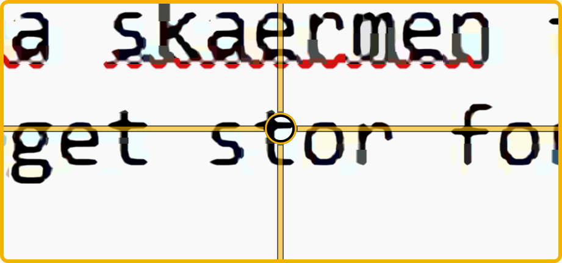

# Skærmlup — AMD-support til Windows

Et forstørrelsesglas til skærmen for mennesker med **AMD** (aldersrelateret makuladegeneration)
og anden nedsat syn. Det forstørrer et område af skærmen — tekst, grafik, billeder, alt hvad
der står der — og kan tændes med **ét tryk på en museknap**, uden at brugeren først skal finde
noget lille og ulæseligt på skærmen.

Lokalt Windows-program. .NET 10 / WPF. Ingen konto, ingen internetforbindelse, ingen data
der forlader maskinen.


Luppen med omvendte farver, 4x forstørrelse. Krydset viser hvor musen står — musepilen kommer
ikke med i en skærmkopi, så luppen tegner den selv, med en åbning i midten så teksten lige
under markøren ikke dækkes.


Vejledningsbjælken står altid fremme og fortæller hvad luppen laver lige nu, og hvilken knap
der ændrer det.

## Sådan bruger man det

| Handling | Hvad der sker |
|---|---|
| **Midterste museknap** | Tænder og slukker luppen. Kan ændres til sideknapperne eller venstre+højre samtidig. |
| **Ctrl + rul på hjulet** | Mere eller mindre forstørrelse (1,5x til 20x). |
| **Skift + rul på hjulet** | Større eller mindre lup. |
| **Ctrl + Alt + L** | Tænd og sluk fra tastaturet. |
| **Ctrl + Alt + plus / minus** | Forstørrelse fra tastaturet. |
| **Ctrl + Alt + Page Up / Down** | Lupstørrelse fra tastaturet. |
| **Ctrl + Alt + K** | Næste farvetilstand. |
| **Ctrl + Alt + B** | Skift mellem lup og læsebånd. |
| **Ctrl + Alt + H** | Vis eller skjul vejledningsbjælken. |
| **Ctrl + Alt + S** | Åbn kontrolpanelet. |
| **Ctrl + Alt + piletaster** | Flyt luppen uden mus. |

Alle genveje står ét sted i koden — [`Shortcuts.cs`](src/Skaermlup.Core/Text/Shortcuts.cs) — og
både registreringen i Windows og alle tekster på skærmen læser derfra. Vejledningen kan altså
ikke komme til at love noget andet end programmet gør.

## De valg der er truffet for brugerens skyld

**Instruktionerne står altid fremme.** En bjælke langs skærmkanten viser med meget stor skrift
om luppen er tændt, hvad den forstørrer, og hvilken knap der ændrer det — også når luppen er
slukket, for ellers ville brugeren ikke kunne se hvordan man tænder den. Bjælken lægger sig i
skærmens arbejdsområde, så den ikke dækker proceslinjen, og kan gøres op til 250 % større.

**Udløseren er en museknap, ikke et ikon.** Knappen sidder allerede under fingeren.
Udløserklikket holdes som standard tilbage, så browseren ikke også åbner en ny fane når luppen
tændes. Knappen kan sættes til at virke som et rigtigt forstørrelsesglas: tændt så længe den
holdes nede.

**Kanterne genrejses ved høj forstørrelse.** Et skærmbillede er pixels, og detaljer der aldrig
blev optaget, kan ingen regnemetode finde frem. Men måden der forstørres på afgør om teksten
kan læses. Almindelig udglatning gør bogstaverne slørede, og firkantforstørrelse laver
trappetrin på alle kurver. Fra tre gange og opefter findes kantens placering ved udglatning —
den er nøjagtig langt ned under en hel pixel — og dens stejlhed genrejses bagefter, så
overgangen bliver lige så smal som på den oprindelige skærm.



**Farvekanterne omkring bogstaver fjernes.** Windows tegner tekst med ClearType, hvor hver
skærmpixels tre farvestriber tændes forskelligt for at placere en bogstavkant en tredjedel
pixel ad gangen. På skærmens egen opløsning smelter striberne sammen for øjet. Forstørret ti
gange bliver de i stedet til brede røde og blå bræmmer — ren støj oven i det man prøver at
læse, og ekstra generende når farvesynet i forvejen er svækket. Farven jævnes derfor ud på
tværs af striberne, mens lysstyrken bliver rørt, så kanten bliver liggende præcis hvor den var.
En rigtig rød knap beholder sin farve, for dens farve er den samme over mange pixels i træk.

**Markøren tegnes selv.** Musepilen kommer ikke med i en skærmkopi. Luppen tegner derfor et
kryds og en ring dér hvor musen står — med en åbning i midten.

**Farver kan vendes.** Syv tilstande: normale farver, kraftig kontrast, omvendte farver, gul på
sort, sort på gul, hvid på sort og gråtoner, plus kontrast og lysstyrke. Omvendte farver er for
mange med AMD den største enkeltforskel.

**Luppen følger skrivemarkøren.** Skriver man i et tekstfelt, flytter luppen med — indtil musen
røres, for musen har altid forkørselsret. Piletasterne kan flytte luppen helt uden mus.

**Kontrolpanelet er selv til at læse.** Brødtekst på 20 punkter, knapper på mindst 56 pixels,
afkrydsningsfelter tegnet forfra i en størrelse der kan ses, og plus/minus-knapper i stedet for
skydeknapper, som er svære både at ramme og at aflæse.


## Hvad en lup ikke kan

Luppen forstørrer et billede af skærmen. Ved ti gange forstørrelse er der kun én hundrededel
så mange rigtige pixels bag hver tomme af det man ser, og de detaljer der aldrig blev optaget,
kan ingen regnemetode finde frem. Kanterne kan gøres skarpe igen — og det gør programmet — men
tegner et program sin tekst med små bogstaver, bliver den forstørrede tekst aldrig lige så fin
som den samme tekst tegnet stor fra begyndelsen.

Derfor er det bedste råd til den der har brug for meget forstørrelse at gøre begge dele:

1. Sæt Windows til at tegne alting større: **Indstillinger → System → Skærm → Skalering**,
   fx 150 % eller 175 %. Nu tegnes bogstaverne stort fra begyndelsen, med rigtige skrifttyper
   og fuld skarphed.
2. I browseren og andre programmer: **Ctrl og plus** gør siden større på samme måde.
3. Brug så luppen til resten. Fire eller fem gange oven i en skærm der allerede er skaleret op,
   giver et markant skarpere billede end femten gange på en uskaleret skærm.

## Sådan er det bygget

```
Skaermlup.Desktop  ──►  Skaermlup.Core
   (WPF + Win32)          (ren logik, ingen Windows-afhængigheder)
```

| Projekt | Ansvar |
|---|---|
| `src/Skaermlup.Core` | Geometri, forstørrelsestrin, farvefiltre, museudløser, indstillinger, alle tekster. Ingen afhængigheder — derfor testbart. |
| `src/Skaermlup.Desktop` | WPF-vinduer, skærmkopiering, globale muse- og tastaturlyttere. |
| `tests/Skaermlup.Tests` | 88 enhedstests af kernen. |

### Sådan vises billedet

1. `BitBlt` fra skærmens DC ned i en genbrugt DIB-buffer (ingen allokering pr. billede).
2. `ColorPipeline` farvebehandler udsnittet med færdigberegnede opslagstabeller.
3. Under tre gange forstørrelse sendes det lille udsnit direkte til grafikkortet, som skalerer
   det op via `Image.Stretch="Fill"`. Det er billigst, og udglatningen kan ikke ses endnu.
4. Fra tre gange og opefter fjernes ClearType-farvekanterne først, og `EdgeUpscaler` regner
   billedet ud i fuld størrelse med kantstyret forstørrelse. Så er der ingen opskalering
   tilbage til grafikkortet, og kanterne står skarpe.

`EdgeUpscaler` er skrevet for at kunne følge med tres gange i sekundet: yderpunkterne i hver
pixels omegn findes én gang pr. billede, kolonneopslaget regnes én gang pr. billede i stedet
for en halv million gange, ensfarvede flader kopieres uden at blive blandet, og arbejdet deles
i nogle få brede bånd — ikke én opgave pr. billedrække, for da koster planlægningen mere end
regnearbejdet. Målt: 1,6 ms pr. billede ved 921x432 pixels.

Lupvinduet er sat til `WDA_EXCLUDEFROMCAPTURE`, så det ikke kan se sig selv — ellers ville
luppen forstørre sit eget billede i en uendelig tunnel. Kan Windows ikke det (ældre udgaver),
siger kontrolpanelet det og anbefaler læsebåndet, hvor kilden pr. konstruktion ligger uden for
båndet.

Vinduerne placeres med `SetWindowPos` i rigtige skærmpixels frem for i WPF's egne enheder. Det
er med vilje: med per-skærm-DPI ville en omregning give et halvt uskarpt billede på en skærm
med skalering.

### Belastning

Målt på en Windows 11-maskine med Release-byggeriet, ved fire gange forstørrelse: cirka **3 %
af én processorkerne** når musen står stille og **8 % når den bevæger sig**. Ved ti gange, hvor
den kantstyrede forstørrelse er i brug, er det **11 %** i ro og **29 %** i bevægelse.

Luppen kører 60 billeder i sekundet når musen flytter sig, og skruer selv ned til 20 når den
står stille — det er derfor tallene i ro er så meget lavere. "Rolig tilstand" i kontrolpanelet
halverer det yderligere.
## Byg og kør

```bash
dotnet run --project src/Skaermlup.Desktop
```

```bash
dotnet test Skaermlup.slnx
```

Installer (kræver [Inno Setup](https://jrsoftware.org/isinfo.php)):

```bash
pwsh installer/build-installer.ps1
```

Resultatet er `installer/out/Skaermlup-Setup-<version>.exe` — self-contained, så .NET ikke
behøver være installeret på maskinen.

## Filer og fejlsøgning

Indstillinger og statusfil ligger under `%LocalAppData%\Skaermlup\`:

- `settings.json` — alle valg. En ødelagt fil lægges til side som `settings.json.ugyldig`,
  og programmet starter på standardindstillingerne.
- `diagnostik.txt` — skrives ved hver opstart: om museknappen og skærmkopieringen fik lov af
  Windows, hvilke genveje der var optaget af andre programmer, og hvor lang tid ét billede tog.

Luppen kan ikke fotograferes udefra, fordi den er skjult for al skærmkopiering. Til support
kan den tegne sig selv:

```bash
Skaermlup.exe --proevebillede=C:\Temp\lup
```

Kører luppen ikke i forvejen, starter den, gemmer billederne og lukker igen. Kører den
allerede — hvilket den gør hos enhver der faktisk bruger programmet — sendes beskeden videre
til den kopi der har luppen, som gemmer billederne og bliver kørende. Gemt bliver et billede
af luppen, vejledningsbjælken, kontrolpanelet og vejledningen. Det er sådan billederne
øverst i denne fil er lavet.

`Skaermlup.exe --start` starter med luppen tændt og uden at åbne kontrolpanelet. Det er den
genvej "Start sammen med Windows" bruger.

## Krav

Windows 10 (version 2004 eller nyere) eller Windows 11, 64 bit. Bygning kræver .NET 10 SDK.

## Licens

[MIT](LICENSE) — kort fortalt: enhver må frit bruge, ændre, dele og videresælge programmet,
også kommercielt, så længe copyright-teksten følger med. Der gives ingen garanti.

Det er valgt med vilje: skal en synskonsulent, en patientforening eller en kommune kunne
installere Skærmlup hos dem der har brug for det — eller bygge videre på det — skal der ikke
først forhandles om lov.

Selve licensteksten står på engelsk. Det er den originale ordlyd, og den bør ikke oversættes:
en oversættelse ville ikke være den samme juridiske tekst.
