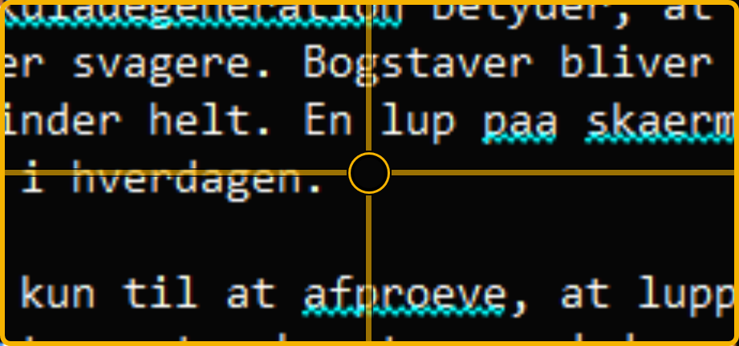
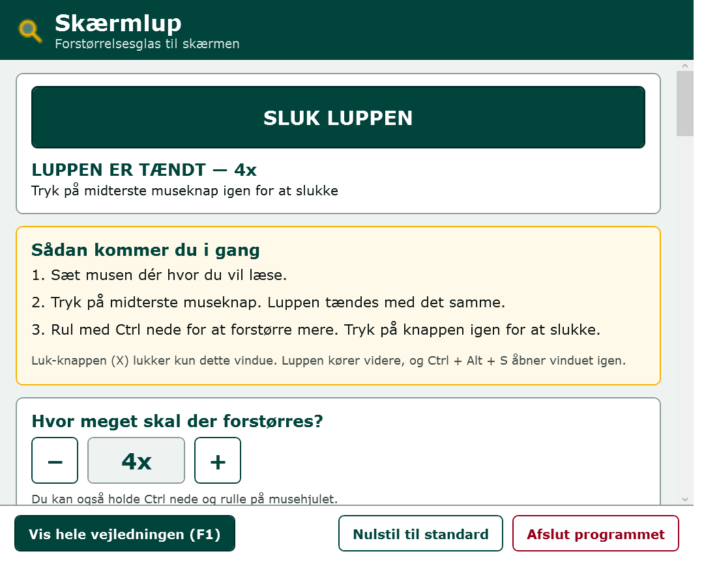

# Skærmlup — AMD-support til Windows

Et forstørrelsesglas til skærmen for mennesker med **AMD** (aldersrelateret makuladegeneration)
og anden nedsat syn. Det forstørrer et område af skærmen — tekst, grafik, billeder, alt hvad
der står der — og kan tændes med **ét tryk på en museknap**, uden at brugeren først skal finde
noget lille og ulæseligt på skærmen.

Lokalt Windows-program. .NET 10 / WPF. Ingen konto, ingen internetforbindelse, ingen data
der forlader maskinen.



Luppen med omvendte farver, 4x forstørrelse. Krydset viser hvor musen står — musepilen kommer
ikke med i en skærmkopi, så luppen tegner den selv, med en åbning i midten så teksten lige
under markøren ikke dækkes.


Vejledningsbjælken står altid fremme og fortæller hvad luppen laver lige nu, og hvilken knap
der ændrer det.

## Sådan bruger man det

| Handling | Hvad der sker |
|---|---|
| **Midterste museknap** | Tænder og slukker luppen. Kan ændres til sideknapperne eller venstre+højre samtidig. |
| **Ctrl + rul på hjulet** | Mere eller mindre forstørrelse (1,5x til 20x). |
| **Skift + rul på hjulet** | Større eller mindre lup. |
| **Ctrl + Alt + L** | Tænd og sluk fra tastaturet. |
| **Ctrl + Alt + plus / minus** | Forstørrelse fra tastaturet. |
| **Ctrl + Alt + Page Up / Down** | Lupstørrelse fra tastaturet. |
| **Ctrl + Alt + K** | Næste farvetilstand. |
| **Ctrl + Alt + B** | Skift mellem lup og læsebånd. |
| **Ctrl + Alt + H** | Vis eller skjul vejledningsbjælken. |
| **Ctrl + Alt + S** | Åbn kontrolpanelet. |
| **Ctrl + Alt + piletaster** | Flyt luppen uden mus. |

Alle genveje står ét sted i koden — [`Shortcuts.cs`](src/Skaermlup.Core/Text/Shortcuts.cs) — og
både registreringen i Windows og alle tekster på skærmen læser derfra. Vejledningen kan altså
ikke komme til at love noget andet end programmet gør.

## De valg der er truffet for brugerens skyld

**Instruktionerne står altid fremme.** En bjælke langs skærmkanten viser med meget stor skrift
om luppen er tændt, hvad den forstørrer, og hvilken knap der ændrer det — også når luppen er
slukket, for ellers ville brugeren ikke kunne se hvordan man tænder den. Bjælken lægger sig i
skærmens arbejdsområde, så den ikke dækker proceslinjen, og kan gøres op til 250 % større.

**Udløseren er en museknap, ikke et ikon.** Knappen sidder allerede under fingeren.
Udløserklikket holdes som standard tilbage, så browseren ikke også åbner en ny fane når luppen
tændes. Knappen kan sættes til at virke som et rigtigt forstørrelsesglas: tændt så længe den
holdes nede.

**Markøren tegnes selv.** Musepilen kommer ikke med i en skærmkopi. Luppen tegner derfor et
kryds og en ring dér hvor musen står — med en åbning i midten.

**Farver kan vendes.** Syv tilstande: normale farver, kraftig kontrast, omvendte farver, gul på
sort, sort på gul, hvid på sort og gråtoner, plus kontrast og lysstyrke. Omvendte farver er for
mange med AMD den største enkeltforskel.

**Luppen følger skrivemarkøren.** Skriver man i et tekstfelt, flytter luppen med — indtil musen
røres, for musen har altid forkørselsret. Piletasterne kan flytte luppen helt uden mus.

**Kontrolpanelet er selv til at læse.** Brødtekst på 20 punkter, knapper på mindst 56 pixels,
afkrydsningsfelter tegnet forfra i en størrelse der kan ses, og plus/minus-knapper i stedet for
skydeknapper, som er svære både at ramme og at aflæse.



## Sådan er det bygget

```
Skaermlup.Desktop  ──►  Skaermlup.Core
   (WPF + Win32)          (ren logik, ingen Windows-afhængigheder)
```

| Projekt | Ansvar |
|---|---|
| `src/Skaermlup.Core` | Geometri, forstørrelsestrin, farvefiltre, museudløser, indstillinger, alle tekster. Ingen afhængigheder — derfor testbart. |
| `src/Skaermlup.Desktop` | WPF-vinduer, skærmkopiering, globale muse- og tastaturlyttere. |
| `tests/Skaermlup.Tests` | 72 enhedstests af kernen. |

### Sådan vises billedet

1. `BitBlt` fra skærmens DC ned i en genbrugt DIB-buffer (ingen allokering pr. billede).
2. `ColorPipeline` kopierer bufferen over i visningen og farvebehandler undervejs med
   færdigberegnede opslagstabeller.
3. Grafikkortet skalerer det lille udsnit op via `Image.Stretch="Fill"`.

Lupvinduet er sat til `WDA_EXCLUDEFROMCAPTURE`, så det ikke kan se sig selv — ellers ville
luppen forstørre sit eget billede i en uendelig tunnel. Kan Windows ikke det (ældre udgaver),
siger kontrolpanelet det og anbefaler læsebåndet, hvor kilden pr. konstruktion ligger uden for
båndet.

Vinduerne placeres med `SetWindowPos` i rigtige skærmpixels frem for i WPF's egne enheder. Det
er med vilje: med per-skærm-DPI ville en omregning give et halvt uskarpt billede på en skærm
med skalering.

### Belastning

Målt på en Windows 11-maskine med Release-byggeriet: cirka **3 % af én processorkerne** når
musen står stille og **8 % når den bevæger sig**. Luppen kører 60 billeder i sekundet når musen
flytter sig, og skruer selv ned til 20 når den står stille. "Rolig tilstand" i kontrolpanelet
halverer det yderligere.

## Byg og kør

```bash
dotnet run --project src/Skaermlup.Desktop
```

```bash
dotnet test Skaermlup.slnx
```

Installer (kræver [Inno Setup](https://jrsoftware.org/isinfo.php)):

```bash
pwsh installer/build-installer.ps1
```

Resultatet er `installer/out/Skaermlup-Setup-<version>.exe` — self-contained, så .NET ikke
behøver være installeret på maskinen.

## Filer og fejlsøgning

Indstillinger og statusfil ligger under `%LocalAppData%\Skaermlup\`:

- `settings.json` — alle valg. En ødelagt fil lægges til side som `settings.json.ugyldig`,
  og programmet starter på standardindstillingerne.
- `diagnostik.txt` — skrives ved hver opstart: om museknappen og skærmkopieringen fik lov af
  Windows, hvilke genveje der var optaget af andre programmer, og hvor lang tid ét billede tog.

Luppen kan ikke fotograferes udefra, fordi den er skjult for al skærmkopiering. Til support
kan den tegne sig selv:

```bash
Skaermlup.exe --proevebillede=C:\Temp\lup
```

Programmet starter, gemmer et billede af luppen, vejledningsbjælken, kontrolpanelet og
vejledningen i mappen, og lukker igen. Det er sådan billederne øverst i denne fil er lavet.

`Skaermlup.exe --start` starter med luppen tændt og uden at åbne kontrolpanelet. Det er den
genvej "Start sammen med Windows" bruger.

## Krav

Windows 10 (version 2004 eller nyere) eller Windows 11, 64 bit. Bygning kræver .NET 10 SDK.
