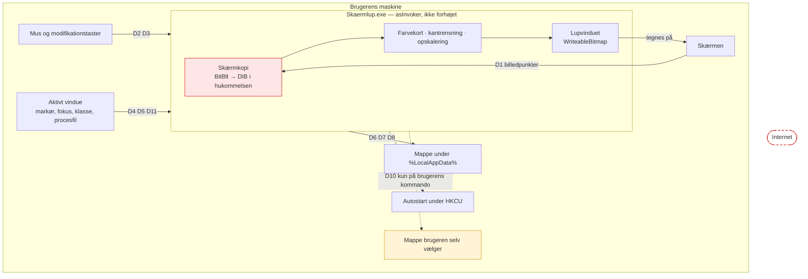

# Dataflow og compliance

Sporing af hver eneste datastrøm i Skærmlup, og hvad den betyder i forhold til GDPR, NIS2,
ISO/IEC 27001 og CRA.

**Version:** Skærmlup 1.4.0 · **Skrevet:** 2026-09-09 · **Gælder commit:** se `git log` for denne fil

---

## Om dokumentet — læs det her først

Dokumentet står på to ben, og de to ben har vidt forskellig vægt:

| Del | Hvad det er | Hvor sikkert |
|---|---|---|
| **Del A — dataflowsporing** | Hvad koden faktisk gør. Hvert punkt har en kildehenvisning og kan efterprøves med kommandoerne i afsnit A.6. | Efterprøvet i koden. Falsificerbart. |
| **Del B — regelfortolkning** | Hvad det formentlig betyder for GDPR, NIS2, ISO og CRA. | Min læsning. Ikke juridisk rådgivning. Bør bekræftes af en jurist eller DPO før noget lægges til grund i et udbud. |

Del A er værktøjet. Del B er et udgangspunkt for en samtale med en jurist — ikke et svar.
Datoer og tærskler i del B skal bekræftes mod den gældende retsakt; regler flytter sig, og
dette dokument gør ikke.

## Systemet i én sætning

Skærmlup er et lokalt Windows-skrivebordsprogram, der læser skærmens billedpunkter, forstørrer
dem og tegner dem i et vindue oven på skærmen. Ingen konto, ingen server, ingen bagvedliggende
tjeneste.

| | |
|---|---|
| Udrulning | Installeres pr. maskine under `%ProgramFiles%\Skaermlup` |
| Rettigheder ved kørsel | `asInvoker` — ikke forhøjede ([app.manifest](../src/Skaermlup.Desktop/app.manifest)) |
| Rettigheder ved installation | Administrator, fordi der skrives til Programmer |
| Tredjepartskode | Én pakke: `CommunityToolkit.Mvvm` 8.4.2. Ingen andre i det udgivne program. |
| Native kald | 56 stk. fordelt på `user32.dll`, `gdi32.dll` og `kernel32.dll`. Ingen andre DLL'er. |

---

# Del A — dataflowsporing

## A.1 Datafortegnelse

Elleve datastrømme. Kolonnen **Forlader maskinen** er den eneste, der for alvor betyder noget.

| # | Data | Hvor det kommer fra | Hvad der sker med det | Hvor det ender | Levetid | Forlader maskinen |
|---|---|---|---|---|---|---|
| **D1** | **Skærmens billedpunkter** i det område luppen dækker | `BitBlt` fra en `DISPLAY`-enhedskontekst | Farvekort, ClearType-kantrensning, kantopskalering | Et `WriteableBitmap` i lupvinduet — altså skærmen | Overskrives ved hvert billede (op til 120/sek.), frigives ved `Dispose` | **Nej** |
| **D2** | Musens position, knapper og hjul, på hele systemet | Lavniveaukrog `WH_MOUSE_LL` | Afgør om luppen skal tænde, zoome eller flytte sig | Hændelsesobjekt i hukommelsen | Pr. hændelse | **Nej** |
| **D3** | Om Ctrl og Skift er nede | `GetAsyncKeyState` — kun de to taster | Afgør hvad musehjulet gør | Ikke gemt | Øjeblikkelig | **Nej** |
| **D4** | Skrivemarkørens rektangel i det aktive vindue | `GetGUIThreadInfo` | Luppen følger med, når man skriver | Ikke gemt | Pr. opslag | **Nej** |
| **D5** | Det forreste vindues klassenavn og procesfil | `GetClassNameW`, `QueryFullProcessImageNameW` | Er det Start-menuen? Så flytter luppen sig | Ikke gemt | Pr. opslag | **Nej** |
| **D6** | Brugerens egne indstillinger | Brugeren i kontrolpanelet | Serialiseres til JSON | `%LocalAppData%\Skaermlup\settings.json` | Til afinstallation eller sletning | **Nej** |
| **D7** | Markør-vagtflag | Programmet selv | Tekstfil med én linje | `%LocalAppData%\Skaermlup\musepil-skjult` | Mens luppen er tændt | **Nej** |
| **D8** | Statusfil | Programmet og Windows | Version, tidspunkt, OS-version, skærmgeometri, om museknap og genveje virker, sti til indstillinger | `%LocalAppData%\Skaermlup\diagnostik.txt` | Overskrives ved hver opstart | **Nej** |
| **D9** | Autostart | Brugerens eget tilvalg | Strengværdi med programstien | `HKCU\...\CurrentVersion\Run\Skaermlup` | Til fravalg eller afinstallation | **Nej** |
| **D10** | **Prøvebilleder til support** | Brugeren kører `--proevebillede=<mappe>` | Vinduerne tegner sig selv til PNG | En mappe **brugeren selv angiver** | Til brugeren sletter dem | **Kun hvis brugeren selv sender dem videre** |
| **D11** | **Hvor tastaturets fokus er** — kun placeringen af feltet | UI Automation: Windows' svar på hvilket felt der har fokus, og dets rektangel | Luppen følger med, når brugeren flytter rundt med Tab | Ikke gemt | Til næste fokusskift. Kun mens luppen er tændt — slukket lyttes der slet ikke | **Nej** |

Kildehenvisninger: D1 [`ScreenCapture.cs`](../src/Skaermlup.Desktop/Capture/ScreenCapture.cs),
[`ColorPipeline.cs`](../src/Skaermlup.Core/Colors/ColorPipeline.cs) ·
D2–D3 [`GlobalMouseHook.cs`](../src/Skaermlup.Desktop/Services/GlobalMouseHook.cs) ·
D4 [`CaretProbe.cs`](../src/Skaermlup.Desktop/Interop/CaretProbe.cs) ·
D5 [`ShellWatch.cs`](../src/Skaermlup.Desktop/Interop/ShellWatch.cs) ·
D6 [`SettingsStore.cs`](../src/Skaermlup.Core/Settings/SettingsStore.cs) ·
D7 [`SystemCursor.cs`](../src/Skaermlup.Desktop/Interop/SystemCursor.cs) ·
D8 [`AppShell.cs`](../src/Skaermlup.Desktop/Services/AppShell.cs) ·
D9 [`StartupRegistration.cs`](../src/Skaermlup.Desktop/Services/StartupRegistration.cs) ·
D10 [`DiagnosticImages.cs`](../src/Skaermlup.Desktop/Services/DiagnosticImages.cs),
[`SampleRequest.cs`](../src/Skaermlup.Desktop/Services/SampleRequest.cs)
· D11 [`FocusTracker.cs`](../src/Skaermlup.Desktop/Interop/FocusTracker.cs)

D11 kommer fra samme kilde som Windows' egen Forstørrelse og Oplæser. Programmet spørger kun om
*hvor* feltet er — aldrig hvad det hedder, og aldrig hvad der står i det, heller ikke i et
adgangskodefelt. Det håndhæves af `efterproev-dataflow.ps1`, der fejler hvis koden begynder at
læse mere end placeringen.

## A.2 Tillidsgrænser



Den røde kasse er den følsomme: **D1 er hele skærmens indhold.** Bruges luppen på en
lægearbejdsplads, går patientjournalen gennem den buffer. Den ligger i hukommelsen, bliver
overskrevet ved næste billede og skrives aldrig til disk — men den er der.

Internettet står i diagrammet uden en eneste streg til sig. Det er ikke en forglemmelse i
tegningen — der er ingen kant at krydse. Se A.5.

## A.3 Den ene vej ud — og hvad den kan komme til at rumme

`--proevebillede=<mappe>` findes, fordi luppen ikke kan fotograferes udefra (den udelukker sig
selv fra skærmkopiering, se A.4). Uden den kunne en supporter ikke se, hvad brugeren ser.

Kommandoen får vinduerne til at tegne sig selv til PNG. **Lupvinduet indeholder forstørret
skærmindhold.** Et prøvebillede kan derfor indeholde hvad som helst, der stod på skærmen i det
øjeblik: en e-mail, et cpr-nummer, en journal.

Det er ikke en fejl — det er hele pointen med billedet — men det betyder:

- Filerne havner i en mappe **brugeren selv angiver**. Programmet vælger ikke, og sender ikke.
- Intet forlader maskinen, medmindre brugeren selv vedhæfter filen i en mail.
- **Derfor advares der nu på skærmen.** Når billederne er gemt, kommer der et vindue i
  programmets egen skriftstørrelse — ikke en systemdialog med lillebitte tekst — der siger
  hvad billederne indeholder, hvor de ligger, og at de skal ses igennem før de sendes. En
  knap åbner mappen, for at finde en mappe frem er svært nok med fuldt syn. Teksterne
  ligger i [`SampleWarning`](../src/Skaermlup.Core/Text/SampleWarning.cs) og er dækket af
  tests, så de ikke kan skrives om til noget venligt og vagt.

## A.4 Sikkerhedsegenskaber der allerede er der

| Egenskab | Hvordan | Hvad det betyder |
|---|---|---|
| **Ingen tastaturaflytning** | Der er ingen `WH_KEYBOARD`-krog i koden. Genveje bruger `RegisterHotKey`, som Windows selv fordeler. `GetAsyncKeyState` spørges kun om Ctrl og Skift. | Programmet kan ikke se, hvad brugeren skriver — heller ikke adgangskoder. |
| **Luppen kan ikke skærmkopieres** | `SetWindowDisplayAffinity(WDA_EXCLUDEFROMCAPTURE)` | Deler brugeren skærm i Teams, kommer det forstørrede indhold ikke med. Omvendt: en fjernsupporter kan ikke se luppen. |
| **Ingen forhøjede rettigheder** | `asInvoker` | Programmet kan ikke mere end brugeren selv. |
| **Ingen udklipsholder** | Ingen `Clipboard`-kald i koden | Rører ikke det, brugeren har kopieret. |
| **Kun brugerens egen registreringsgren** | `Registry.CurrentUser` | Ingen maskinbrede ændringer efter installation. |
| **Lille angrebsflade** | Én tredjepartspakke, tre system-DLL'er | Meget lidt at holde øje med i forsyningskæden. |
| **Installeren kan bede programmet lukke pænt** | Navngivne signaler med egne rettigheder ([`InstanceSignals.cs`](../src/Skaermlup.Desktop/Services/InstanceSignals.cs)). Administratorer må se at programmet kører og bede det lukke eller glemme sin autostart — intet andet | En pæn nedlukning giver musepilen tilbage; en tvungen gør ikke. Administratorer kunne i forvejen lukke programmet med magt, så retten giver dem intet nyt. |

## A.5 Det der ikke sker — og hvor stærkt det er efterprøvet

De negative påstande er de vigtigste i dokumentet, så her står præcis hvor langt beviset rækker.

| Påstand | Hvordan det er efterprøvet | Styrke |
|---|---|---|
| Ingen netværkskald i programmets egen kode | Søgning efter `HttpClient`, `WebClient`, `WebRequest`, `Socket`, `System.Net`, `Dns`, `TcpClient`, `UdpClient`, `SmtpClient`, `WebSocket`, `HttpListener` i al kildekode: **nul træffere** | Stærk for førstepartskoden |
| Ingen netværk via tredjepart | Én pakke i det udgivne program: `CommunityToolkit.Mvvm` (MVVM-hjælpeklasser, ingen I/O) | Stærk |
| Ingen netværk via native kald | 56 `DllImport` mod udelukkende `user32`, `gdi32`, `kernel32`. Ingen `wininet`, `winhttp`, `ws2_32` | Stærk |
| Ingen telemetri, ingen nedbrudsrapportering, ingen opdateringstjek | Ingen sådan kode findes; den eneste udgående kanal ville være netværk, og det er dækket ovenfor | Stærk |
| Ingen tastaturaflytning | Ingen `WH_KEYBOARD`-krog. `GetAsyncKeyState` kun for Ctrl og Skift | Stærk |
| **Programmet åbner ingen forbindelser under kørsel** | Observeret på den installerede 1.3.0 i almindelig brug: **`ws2_32.dll` er aldrig indlæst**, og nul endepunkter over 15 målinger | Stærk — se nedenfor |

### Kørselsmålingen

Målt 2026-09-09 på `C:\Program Files\Skaermlup\Skaermlup.exe` 1.3.0.0, mens programmet havde
kørt i syv minutter med luppen tændt i normal brug:

| Måling | Resultat |
|---|---|
| Indlæste moduler i alt | 140 |
| `ws2_32.dll` (Winsock) | **Ikke indlæst** |
| `mswsock.dll` | **Ikke indlæst** |
| `dnsapi.dll` (navneopslag) | **Ikke indlæst** |
| `winhttp.dll`, `wininet.dll`, `schannel.dll` | **Ikke indlæst** |
| TCP-forbindelser, 15 målinger over 60 sekunder | **0** |
| UDP-endepunkter, 15 målinger over 60 sekunder | **0** |

**Det afgørende er den manglende `ws2_32.dll`.** Et Windows-program kan ikke oprette en TCP-
eller UDP-forbindelse uden at Winsock er indlæst i processen. At biblioteket aldrig er kommet
ind, er derfor ikke blot "vi så ingen trafik i det øjeblik vi kiggede" — det er, at der aldrig
har eksisteret en forbindelse at se.

**Ærligt forbehold — fire `System.Net`-assemblies *er* indlæst:** `System.Net.Primitives`,
`System.Net.Requests`, `System.Net.WebClient` og `System.Net.WebHeaderCollection`. De kommer fra
WPF selv, som slår `WebRequest` op i sin håndtering af `pack:`-adresser og billedindlæsning.
Typerne er altså i hukommelsen. De er bare aldrig brugt til at åbne noget — og det er præcis
det, den manglende Winsock beviser. Havde en af dem været taget i brug, ville `ws2_32.dll` have
været der.

Målingen gentages sådan her:

```powershell
$p = Get-Process Skaermlup
($p.Modules | ForEach-Object { (Split-Path $_.FileName -Leaf).ToLower() }) -contains 'ws2_32.dll'
Get-NetTCPConnection -OwningProcess $p.Id -ErrorAction SilentlyContinue
Get-NetUDPEndpoint  -OwningProcess $p.Id -ErrorAction SilentlyContinue
```

Første linje skal give `False`, de to sidste tomt. Skal det stå endnu stærkere over for en
indkøbsafdeling, så lad en udgående firewall-regel blokere `Skaermlup.exe` og bekræft, at
programmet fungerer uændret.

## A.6 Sådan efterprøves hele del A

Kør [`efterproev-dataflow.ps1`](efterproev-dataflow.ps1) fra roden af arkivet. Den gentager alle
søgningerne ovenfor og fejler, hvis en påstand ikke længere holder:

```powershell
pwsh -File docs/efterproev-dataflow.ps1
```

Ændrer koden sig, så en påstand falder, siger scriptet fra. **Dette dokument skal opdateres i
samme commit som den ændring, der får scriptet til at fejle.** Ellers rådner det, og en
compliance-erklæring der er rådnet er værre end ingen.

---

# Del B — regelfortolkning

> Herfra og ned er det min læsning, ikke efterprøvede fakta. Ikke juridisk rådgivning.
> Tærskler, datoer og artikelnumre skal bekræftes mod den gældende retsakt.

## B.1 GDPR — den forordning der faktisk handler om data

Databeskyttelsesforordningen er den, der rammer et program som dette. NIS2 og ISO handler om
sikkerhed og styring; GDPR handler om personoplysningerne selv.

**Rollefordelingen er det afgørende.** Skærmlup behandler personoplysninger — D1 er hele
skærmens indhold — men udvikleren modtager dem aldrig. Ingen data forlader maskinen, og der er
ingen tjeneste at modtage dem på.

| Rolle | Hvem | Hvorfor |
|---|---|---|
| Dataansvarlig | Den organisation, der ruller luppen ud | Bestemmer formål og midler for det, der står på deres skærme. Det gjorde de i forvejen. |
| Databehandler | **Ingen** | Udvikleren behandler ikke oplysninger på nogens vegne. Der er intet at indgå en databehandleraftale om — se nedenfor. |
| Leverandør af et værktøj | Udvikleren | Som en leverandør af et tastatur eller en skærm |

**Om databehandleraftalen:** en indkøbsafdeling vil ofte bede om en artikel 28-aftale af vane.
Den korrekte reaktion er ikke at underskrive en, men at forklare hvorfor der ikke skal være en —
og lægge dette dokument ved som dokumentation. Underskriver man en databehandleraftale for en
behandling, der ikke finder sted, påtager man sig forpligtelser uden modstykke.

Relevante bestemmelser og hvordan de står:

| Bestemmelse | Vurdering |
|---|---|
| **Art. 25** — indbygget databeskyttelse | Stærk. Ingen indsamling er den mest vidtgående dataminimering der findes. Del A er dokumentationen. |
| **Art. 30** — fortegnelse over behandlinger | Den dataansvarlige skal føre den. Datafortegnelsen i A.1 er råstoffet, klar til at klippe ind. |
| **Art. 32** — behandlingssikkerhed | Ingen transmission, ingen lagring af skærmindhold, ingen forhøjede rettigheder. Bemærk dog G1 og G2 nedenfor. |
| **Art. 9** — særlige kategorier | På en sundhedsarbejdsplads går helbredsoplysninger gennem D1. Det er stadig kundens behandling, ikke udviklerens — men det hæver kravet til D10. |
| **Art. 35** — konsekvensanalyse | En lup udløser næppe en selvstændig DPIA. Ruller et hospital den ud på kliniske arbejdsstationer, hører den hjemme som en linje i den DPIA, der allerede findes for arbejdsstationen. |

## B.2 NIS2 — rammer sandsynligvis ikke projektet, men kommer alligevel

NIS2 (direktiv (EU) 2022/2555) gælder for enheder i bestemte sektorer over bestemte
størrelsestærskler. Et enkeltmandsprojekt, der laver et hjælpemiddel, er efter min læsning
**ikke en omfattet enhed**. Hverken sektor eller størrelse passer.

**Men det kommer ind ad bagdøren.** Sælges luppen til et hospital, en kommune eller en region, er
*de* omfattet, og NIS2 pålægger dem at styre sikkerheden i deres forsyningskæde (art. 21, stk. 2,
litra d). Så kommer kravene videre ned som spørgeskemaer i et udbud. Det er den vej, NIS2 rammer
dette projekt — som leverandørkrav, ikke som egen forpligtelse.

Hvad der typisk bliver spurgt om, og hvor projektet står:

| Forventning i forsyningskæden | Status |
|---|---|
| Sikker udvikling og versionsstyring | **God.** Alt i Git, 191 tests, lagdelt arkitektur med en kerne uden systemafhængigheder |
| Håndtering af sårbarheder | **God.** [SECURITY.md](../SECURITY.md) med adresse og svarfrister |
| Styklister over komponenter (SBOM) | **God.** CycloneDX, genereret ud af byggeriet ved hver udgivelse |
| Integritet af det udleverede | **Mangler.** Installeren er ikke kodesigneret. Se G1 |
| Hændelseshåndtering | **Ikke relevant** som enhed, men kunden vil vide, hvordan de får fat i udvikleren |
| Kryptering, adgangsstyring, netværkssikkerhed | **Ikke relevant.** Der er ingen tjeneste, ingen konti og ingen netværkstrafik |

Den danske gennemførelse af NIS2 skal slås efter i sin nuværende form, før noget af dette lægges
til grund over for en myndighed. Jeg angiver bevidst ingen dato her.

## B.3 ISO/IEC 27001 — brug kontrollisten, glem certificeringen

ISO/IEC 27001 certificerer et ledelsessystem, ikke et program. Et enkeltmandsprojekt kan ikke
meningsfuldt certificeres, og det ville heller ikke gøre luppen bedre. Værdien ligger i Annex A
som huskeliste. De kontroller der faktisk kan bæres af et projekt som dette:

| Kontrol (27001:2022) | Status |
|---|---|
| A.8.25 Sikker udviklingslivscyklus | **God.** Fast rytme med tests og versioner, og en skreven [trusselsmodel](trusselsmodel.md) |
| A.8.26 Sikkerhedskrav til programmet | **Delvis.** Kravene står i README og her, ikke som selvstændige krav |
| A.8.28 Sikker kodning | **God.** `nullable` slået til, `unsafe` kun i skærmkopieringen, nul advarsler i byg |
| A.8.8 Håndtering af tekniske sårbarheder | **Delvis.** Kanal til indrapportering findes nu; afhængigheder gennemgås stadig ikke systematisk. Kun én pakke, så arbejdet er småt |
| A.8.31 Adskilte miljøer | **God.** Byg og test kører også i en container uden Windows-afhængigheder |
| A.8.32 Ændringsstyring | **God.** Alt gennem Git med sporbare commits; udgivelser bærer commit-id i `ProductVersion` |
| A.5.20/5.21 Leverandørkæde | **God i praksis.** Én afhængighed, tre system-DLL'er |
| A.8.4 Adgang til kildekode | **God.** Privat arkiv, én ejer |

Andre standarder der er værd at kende, hvis luppen skal sælges:

- **ISO/IEC 27701** — udvidelse af 27001 til privatlivsbeskyttelse. Samme svar: brug den som
  liste, ikke som mål.
- **ISO 9241-171** — tilgængelighed i software. Den, der ligger nærmest produktets egen sag, og
  den eneste jeg ville overveje at måle op imod for alvor.
- **EN 301 549** og tilgængelighedsdirektivet — relevant hvis luppen sælges eller udbydes til
  offentlige myndigheder. Et hjælpemiddel bliver ikke undtaget fra selv at være tilgængeligt.

## B.4 CRA — den der reelt kommer til at binde

Cyberresiliensforordningen (forordning (EU) 2024/2847) gælder produkter med digitale elementer,
der bringes i omsætning i EU. Efter min læsning:

- **Lige nu: uden for.** Luppen er gratis, arkivet er privat, og den bringes ikke i omsætning.
  Fri og open source-software leveret uden for erhvervsmæssig virksomhed er i vidt omfang undtaget.
- **Hvis den sælges, eller distribueres bredt som led i erhvervsmæssig virksomhed: indenfor.**
  Så følger krav om sikker udvikling, håndtering af sårbarheder gennem hele levetiden,
  indberetning af aktivt udnyttede sårbarheder, SBOM og CE-mærkning.

Forpligtelserne indfases, og de første falder før den fulde anvendelse. **Datoerne skal slås
efter** — jeg angiver dem ikke her, fordi et forkert årstal i et compliance-dokument er værre end
et manglende.

Det praktiske råd: G1, G4 og G5 nedenfor er præcis dem, CRA vil kræve. Laves de nu, mens de er
små, er der ingenting at haste med senere.

## B.5 Huller, i den rækkefølge de bør lukkes

| # | Hul | Hvorfor det betyder noget | Omfang |
|---|---|---|---|
| **G1** | **Installeren er ikke kodesigneret** | Brugeren kan ikke se, om filen er ægte, og SmartScreen advarer ved hver installation. En bruger med AMD, der er blevet lært at klikke advarsler væk, er en sikkerhedsrisiko i sig selv. Rammer NIS2-forsyningskæde, CRA og A.8.25 på én gang | Køb af certifikat. Byggeriet er klar via `-CertificateThumbprint` |
| **G2** | **Prøvebilleder kan indeholde alt** | Se A.3. Brugeren kan i sagens natur ikke altid læse, hvad billedet viser, før det sendes | Lille |
| ~~**G3**~~ | ~~Ingen advarsel på skærmen ved `--proevebillede`~~ | **Lukket.** Efter et prøvebillede vises et vindue i programmets egen skriftstørrelse: billederne viser hvad der stod på skærmen, se dem igennem før de sendes. Knap der åbner mappen. Teksterne ligger i `SampleWarning` og er dækket af tests | Gjort |
| ~~**G4**~~ | ~~Ingen kanal til at melde sårbarheder~~ | **Lukket.** [SECURITY.md](../SECURITY.md): adresse, svarfrister, hvad der er i spil og hvad der er design | Gjort |
| ~~**G5**~~ | ~~Ingen SBOM~~ | **Lukket.** CycloneDX 1.6 i [docs/sbom/](sbom/), genereret af `installer/lav-sbom.ps1` ud af `Skaermlup.deps.json` — ikke skrevet i hånden | Gjort |
| ~~**G6**~~ | ~~Kørselsobservation mangler~~ | **Lukket.** Målt på den installerede 1.3.0: `ws2_32.dll` aldrig indlæst, nul endepunkter. Se A.5 | Gjort |
| ~~**G7**~~ | ~~Ingen skreven trusselsmodel~~ | **Lukket.** [Trusselsmodel](trusselsmodel.md): fem angribertyper, otte trusler. Konklusionen er at T1 — falsk installer — er den tungeste, og at den kun løses med G1 | Gjort |

**Kun G1 står tilbage** — og det er samtidig den tungeste trussel i
[trusselsmodellen](trusselsmodel.md). Den er også den eneste, der koster penge frem for
arbejde.

G2 er ikke et hul, der kan lukkes: et prøvebillede *skal* vise skærmen for at være til
nogen nytte. G3 gør risikoen synlig for den, der løber den, og det er så langt et program
kan komme.

## B.6 Hvad man svarer i et udbud

Den korte version, til at klippe ind i et spørgeskema:

> Skærmlup er et lokalt Windows-program uden konto, server eller netværksforbindelse. Programmet
> forstørrer skærmens indhold i maskinens egen hukommelse og gemmer aldrig skærmindhold på disk.
> Der sendes ingen data til leverandøren, og leverandøren er derfor hverken dataansvarlig eller
> databehandler efter databeskyttelsesforordningen. Programmet lagrer alene brugerens egne
> indstillinger og en statusfil lokalt under brugerens profil. Der er ingen tastaturaflytning, og
> programmet kører uden forhøjede rettigheder. Dataflowet er sporet og efterprøvet i
> kildekoden — se `docs/dataflow-og-compliance.md` i leverancen.

Lad være med at sende afsnittet alene. Send dokumentet, og lad del A stå for beviset.

---

## Vedligeholdelse

Dette dokument er kun sandt for den commit, det står i. Det skal gennemgås når:

- der føjes en afhængighed til `Skaermlup.Desktop`
- der skrives til en ny fil, mappe eller registreringsnøgle
- der tilføjes et `DllImport` mod en anden DLL end `user32`, `gdi32` og `kernel32`
- `efterproev-dataflow.ps1` fejler
- der overhovedet kommer noget netværk i programmet — så skal hele del A skrives om

Sidst efterprøvet mod koden: 2026-09-09, Skærmlup 1.4.0.
